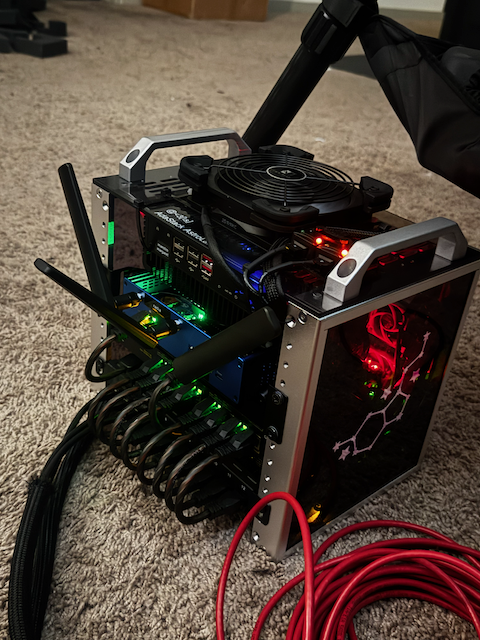

# **_Ada Lovespace_** `@<3[\s]`  
#### A Heterogeneous Distributed Edge AI Field Lab for Real-Time Astrophysical Analysis  


## ⁉️ What is this?

The Ada Lovespace project is a high-fidelity prototype of modern astrophotography and observatory-based research infrastructure. It comprises of two main units:  
* `AdaScope`, Bring your own scope, Ada will provide the brain and dedicated PHD2 guiding engine for rock solid scope control and resilient guiding performance.
* `AdaStack`, your personal field data center. This mini rack is stacked with enough ponies to handle the most demanding of projects.    

It's modularly designed and built around a small, highly resilient, low-power distributed edge AI cluster that expands automation and data pipelining applications, enabling more from your astro gear than you ever thought possible. Your ideas are the new bottleneck! ;) 

Whether it's running a swarm of IoT sensors for real-time inference-driven event detection, experimenting with distributed scope clustering, or processing large volumes of astrophysical data onsite without disturbing core imaging — Ada Lovespace pushes the boundaries of what's possible in astrophotography and observatory research while sipping watts.

This project is intended for the hardcore hobbyist and anyone looking to learn technologies like MQTT pipelines, distributed computing, machine learning, data science, niche architectures like RISC-V, and more — all while honoring the legacies of STEM's most badass ladies.

With that, let's meet the Ada Lovespace gang...

## > Namesakes & Tributes

Ada Lovespace is currently comprised of **6 nodes**: two on-scope and four in a mini-rack enclosure placed near the rig. Each node is named after a pioneering woman in STEM whose work laid the groundwork for precision computing, network architecture, or observational astronomy.

### `AdaBrain` | Ada Lovelace (1815–1852)

English mathematician and writer Ada Lovelace envisioned programmable computation long before mechanical computers existed, authoring the first algorithm for Charles Babbage's Analytical Engine and proving that machines could manipulate abstract symbols — not just perform arithmetic. While her work predated modern astronomy by decades, her computational framework became indispensable to today's automated observatories, where precise control logic and real-time data routing turn raw photon counts into publishable catalogs.

AdaBrain channels this pioneering architecture as your scope-mounted INDI web server: exposing local telemetry, managing mount/camera parameters via the INDIGO/INDI protocol stack, and serving as the conceptual heart of Ada Lovespace itself. Positioned at the optical frontier, it reminds us that every exposure begins with a single well-crafted instruction — and that modern astrophotography pipelines still run on her original blueprint for programmable machines.

### `Caroline-V` | Caroline Herschel (1750–1848)

German-British astronomer Caroline Herschel independently discovered eight comets, cataloged hundreds of nebulae, and pioneered systematic data reduction techniques that turned observational astronomy into a reproducible science. She also developed efficient mechanical calculation methods to automate ephemeris computations — early computational optimization in practice.

Caroline-V honors her as your RISC-V inference engine: delivering low-power, high-efficiency AI processing for real-time object detection, defect mapping, and image analysis at the edge of your observatory stack, where every watt counts.

### `JakeBase` | Elizabeth "Jake" Feinler (1931–present)

Elizabeth "Jake" Feinler was instrumental in building the early Internet, managing ARPANET's first Network Information Center and designing the host directory that made distributed computing scalable and discoverable. She championed open data standards when most networks were proprietary silos.

JakeBase channels her infrastructure-first philosophy as your central NFS/PostgreSQL/MQTT broker — routing telemetry, persisting raw FITS catalogs, and ensuring every edge node can reliably publish, subscribe, and back up its astronomical findings across the lab's local fabric without single-point bottlenecks.

### `Margaret` | Margaret Hamilton (1936–present)

As lead software engineer for NASA's Apollo missions, Margaret Hamilton pioneered real-time flight systems architecture and effectively founded modern software engineering. Her team demonstrated that rigorous design patterns, exhaustive testing, and graceful error recovery can keep critical systems functional under extreme failure conditions. While her work was aerospace rather than astronomical, the same principles of timing-critical orchestration apply directly to astrophotography: Margaret runs your KStars/Ekos stack, synchronizing mount tracking, filter wheels, camera triggers, and environmental sensors into a single fault-tolerant capture pipeline.

### `MaryGuider` | Mary Somerville (1780–1827)

Scottish polymath Mary Somerville transformed observational astronomy into a mathematical science through her work in celestial mechanics and geodesy. She translated Laplace's *Mécanique Céleste*, authored foundational textbooks, and calculated planetary perturbations that directly enabled John Couch Adams to predict Neptune's existence before it was observed.

Her legacy of precision-driven computation aligns perfectly with MaryGuider's role as a dedicated PHD2 guiding engine — where sub-arcsecond tracking accuracy and unwavering loop discipline keep your optics locked on target through the longest, coldest exposures.

### `RadiaWrt` | Radia Perlman (1951–present)

Network architect Radia Perlman invented Spanning Tree Protocol (STP), solving critical routing loops in early Ethernet networks and enabling reliable, scalable topologies to become the backbone of modern networking. Her designs prioritize resilience without sacrificing throughput or introducing unnecessary latency.

RadiaWrt embodies this engineering philosophy as your dedicated OpenWrt router — handling inter-node synchronization, traffic shaping, and fault-tolerant connectivity so data flows cleanly between capture, processing, and storage layers even when cables are swapped or nodes reboot mid-session.

## > Mission

Use this project to perform three demo builds:

### 1. Single-scope `SynapseHorde`

A system of custom ESP32 sensor pods ("Synapse Pods") placed systematically inside and outside the Newtonian tube and around the local area near the rig. Sensor data flows via MQTT at variable rates to the edge lab, where Python tools like Plotly visualize a 3D model of temperature, humidity, pressure, light level, and sound. These data points — combined with accelerometer and guiding image data — feed into the inferencing engine to detect:

- Micro-vibrations
- Macro-vibrations from wind
- Light leaks inside the tube (real-time)
- Heat currents

**Example workflow:** if the imaging plan is set for 8 PM but heat currents are still detected inside the tube, a "pre-run heatcurrent-hold" subroutine kicks in — putting non-essential systems on low power and monitoring until conditions clear, then recalculating the plan and refocusing. During a run, a detected light leak pauses imaging and triggers an NTFY alert. This is the *"set it and forget it"* build so you can actually enjoy the night sky after setup.

### 2. Multi-scope `NarrowBandCannon`

A 3+ (factor-of-3) distributed scope cluster using small, wide-field refractors with monochrome cameras. Each scope node is responsible for a single narrowband channel for the entire session plus 1/n of broadband data for star processing — collecting narrowband light data concurrently across all nodes simultaneously. This reduces real capture time for total integration time: all channels represent data for the same time window.

Using centralized NPU via the astro edge lab in conjunction with federated NPU scope nodes ensures each scope is framed precisely and optics/focus are within reasonable tolerance (FWHM-based). Scope NPUs handle local events like refocus and plan recalibration, while the astro lab manages cluster-wide events like *"clouds incoming — finish current sub then sleep for N min and report back."* Each scope is free to drizzle at will.

### 3. Multi-scope `BroadBandBazooka`

A 2+ (no factor constraint) scope cluster using color cameras with the same multinodal mix-manager strategy as NarrowBandCannon. Instead of hard-focusing all scopes on the same target, each scope node targets a designated pane within a larger panelled image area — cutting the per-scope imaging workload by N×.

With enough scope nodes, private citizens could run their own self-hosted Vera Rubin–style *"All Sky Scan"* projects: as the cluster frames and slews around the sky as an aggregated panelled plan with high total integration time vs. real imaging time ratio. Each scope hard-focuses the same pane all night, stitching together a full-session all-sky mosaic with `session_time × N_nodes` of total integration time.

---

## 📂 Repository Structure
The repository is organized into the following directories:
TODO

## > Drew's Current Setup

> [!NOTE]
> The hardware details below serve as contextual knowledge for agentic workflows. This section will be converted to a **"Recommended Hardware & Setup"** when the project is ready for publication.

TDP values are included per-node to support system debriefing analyses — cross-reference with cooling configuration and actual measured draw during imaging sessions to build thermal profiles and power budget models.

### 🔭 `AdaScope` | Automagical Astrograph 🔭

#### `AdaBrain`
- **Namesake:** Ada Lovelace
- **Role:** Scope Pilot
- **Services:** INDI Web Server
- **Hardware — Raspberry Pi 5 (4GB)**
  - Architecture: `arm64`
  - CPU: BCM2712 Quad-core Cortex-A76 @ 2.4GHz
  - Memory: 4GB LPDDR4X
  - Storage: microSD card
  - Networking:
    - 1× Gigabit Ethernet → cluster
    - 1× USB-to-Ethernet → MaryGuider (Pi Zero 2W)
  - Power: 5V PoE adapter
  - TDP: ~7W max
  - Cooling: Active (heatsink + fan assumed for sustained INDI web serving)

#### `MaryGuider`
- **Namesake:** Mary Somerville
- **Role:** Guiding Navigator
- **Services:** PHD2
- **Hardware — Raspberry Pi Zero 2W**
  - Architecture: `arm64`
  - CPU: BCM27A1 Quad-core Cortex-A53 @ 1.0GHz
  - Memory: 512MB SDRAM
  - Storage: microSD card
  - Networking:
    - 1× USB-to-Ethernet (Gadget mode) → AdaBrain
    - Wi-Fi for cluster comms
  - Power: USB bus-powered from AdaBrain
  - TDP: ~2W
  - Cooling: Passive (no fan; low sustained load)

### `AdaStack` | Astro Edge Lab  

  

#### `Caroline-V`
- **Namesake:** Caroline Herschel
- **Role:** Inference Engine
- **Hardware — StarFive VisionFive 2**
  - Architecture: `riscv64`
  - CPU: StarFive JH7110 Quad-core SiFive XuanTie C910 RISC-V @ 1.5GHz
  - NPU: Hailo-8L @ 13 TOPS (PCIe NPU module)
  - Memory: 8GB LPDDR4
  - Storage: 64GB microSD card
  - Networking: 2× Gigabit Ethernet
  - Power: PoE HAT
  - TDP: ~5W (SoC) + ~4W (Hailo-8L) ≈ 9W total
  - Cooling: Heatsink on SoC + PCIe NPU

#### `JakeBase`
- **Namesake:** Elizabeth "Jake" Feinler
- **Role:** Data Broker
- **Services:** NAS, PostgreSQL, MQTT broker, NTFY server, Telegraf
- **Hardware — Raspberry Pi 5 (8GB)**
  - Architecture: `arm64`
  - CPU: BCM2712 Quad-core Cortex-A76 @ 2.4GHz
  - Memory: 8GB LPDDR4X
  - Storage: 2TB NVMe SSD via 52Pi NVMe+PoE HAT
  - Networking: 1× Gigabit Ethernet
  - Power: PoE HAT
  - TDP: ~7W max
  - Cooling: Active (NVMe + sustained disk I/O under PostgreSQL/NAS load)

#### `Margaret`
- **Namesake:** Margaret Hamilton
- **Role:** Orchestration Maestro
- **Services:** NoMachine, KStars, Ekos
- **Hardware — Intel N100 Mini PC (Hunsn RJ35)**
  - OS: Ubuntu 24.04 LTS
  - Kernel: 6.8.0-134-generic
  - Architecture: `x86_64`
  - CPU: Intel N100 Quad-core @ 3.4GHz (Alder Lake-N)
  - GPU: Intel UHD Graphics (Alder Lake-N)
  - Memory: 16GB DDR5
  - Storage: 256GB SATA SSD
  - Networking: 4× 2.5GbE ports
  - Power: 12V DC
  - TDP: 6W
  - Cooling: Passive (fanless mini PC chassis)

#### `RadiaWrt`
- **Namesake:** Radia Perlman
- **Role:** Network Operator
- **Hardware — BananaPi OpenWrt One**
  - SoC: MediaTek MT7981B Filogic 820 (Quad-core Cortex-A53, `arm64`)
  - Wi-Fi: MediaTek MT7976C — Dual-band WiFi 6 (2×2 2.4GHz + 3×3 5GHz)
  - Memory: 1GB DDR4
  - Storage: 256 MiB SPI NAND + 16 MiB SPI NOR (dual-flash redundancy for unbrickability)
  - NVMe: M.2 2242/2230 socket (PCIe Gen 2 ×1)
  - Additional: RTC support, MikroBUS expansion socket
  - Networking: 1× 2.5GbE RJ45 + 1× Gigabit Ethernet RJ45
  - Power: PoE (802.3af/at)
  - TDP: ~5W (SoC estimate)
  - Cooling: Passive
- **Switch — Netgear GS308PP**
  - Throughput: 1Gbps per port (8 ports)
  - PoE budget: 83W+

### 🏠 `NookStack` | Home Data Center, Research Lab & Studio 🏠

#### `LabWrt`
- **Role:** Secondary Network Operator
- **Location:** Rack shelf
- **Hardware — NanoPi R6S**
  - OS: OpenWrt
  - Architecture: `arm64`
  - SoC: Rockchip RK3588 (Octa-core Cortex-A76/A55)
  - Networking: Integrated interfaces
  - TDP: ~6–8W (RK3588 SoC estimate)
  - Cooling: Passive / passive+heatsink
- **Switch — Sodola 24-Port 2.5Gbps unmanaged**

#### `MacDaddyPro`
- **Role:** Development, Research & Studio
- **Location:** Desk, mobile
- **Hardware — MacBook Pro**
  - OS: macOS 15.7.5
  - Architecture: `arm64` (Apple Silicon)
  - CPU/GPU: Apple M2 Max (12-core CPU, 38-core GPU, SoC)
  - Memory: 96GB unified
  - Storage: 4TB NVMe SSD
  - Power: USB-C / MagSafe (mobile, no fixed PSU)
  - TDP: ~30W sustained peak (M2 Max configurable up to ~60W TDP)
  - Cooling: Active (fan-based laptop thermal system)

#### `CoffeeCan`
- **Role:** Hypervisor, Data Broker
- **Location:** Rack-mount
- **Hardware — 2013 Mac Pro (MacPro6,1)**
  - OS: Proxmox VE (Debian-based hypervisor)
  - Architecture: `x86_64`
  - CPU: Intel Xeon E5-2697 v2 (12C/24T, 2.7GHz base / 3.5GHz turbo) — 1 socket
  - GPU: Dual AMD Radeon RX 570 / R7 370 / R9 270X (Curacao XT GCN 1.0, 1280 SP, 2GB GDDR5 ×2)
  - Memory: 64GB ECC DDR3
  - Storage: 1TB NVMe SSD
  - TDP: 80W (CPU per-core TDP, single-socket)
  - Cooling: Passive (server chassis with internal fans)
- **External Storage:**
  - `BigRed` — 36TB USB RAID1 drive
  - `LilBlu` — 12TB USB RAID5 drive

#### `Poggerbox`
- **Role:** CUDA Engine & GPU Compute
- **Location:** Rack-mount
- **Hardware — Custom Build**
  - OS: Linux Mint Cinnamon 22.3 LTS
  - Architecture: `x86_64`
  - CPU: Intel Core i9-9900K (8C/16T, up to 5.0GHz)
  - GPU: NVIDIA RTX 3080 Ti
  - Memory: 32GB DDR4
  - Storage: 500GB M.2 NVMe SSD
  - Networking: 2.5GbE
  - TDP: 125W (CPU) + 350W (GPU) ≈ 475W peak
  - Cooling: Active (airflow tower case, multi-fan GPU cooler)

#### `VisionForge`
- **Role:** Caroline-V Building & Testing
- **Location:** Rack Shelf
- **Hardware — StarFive VisionFive 2**
  - Architecture: `riscv64`
  - CPU: StarFive JH7110 Quad-core SiFive XuanTie C910 RISC-V @ 1.5GHz
  - Memory: 8GB LPDDR4
  - Storage: 1TB NVMe SSD (PCIe)
  - Networking: 2× Gigabit Ethernet
  - Power: USB-C
  - TDP: ~5W (SoC)
  - Cooling: Passive (Heatsink Case)

---

## 📜 License

This project is licensed under the [MIT License](LICENSE). You are free to use, modify, and distribute this code for any purpose — commercial or otherwise — as long as you include the original copyright notice.

## 🎓 Citing Ada Lovespace

If you use this work in research, presentations, academic papers, or commercial products, we kindly ask that you cite this project:

```bibtex
@software{adalovespace2025,
  author       = {Drew Van de Grift},
  title        = {{Ada Lovespace}: A Heterogeneous Distributed Edge AI Field Lab for Real-Time Astrophysical Analysis},
  version      = {0.1.0},
  year         = 2025,
  url          = {https://github.com/dvandagriff/adalovespace},
  license      = {MIT}
}
```
