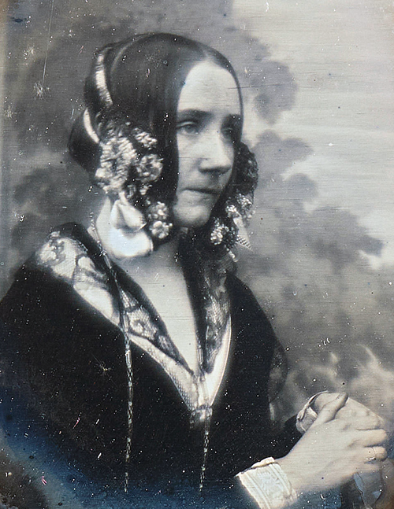
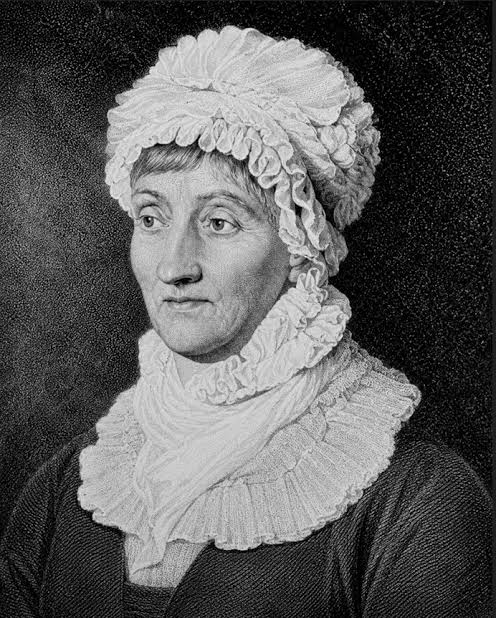

<div align="center">


   

</div>

---

<div align="center">

# `@<3[\s]` // AdaLovespace

**A declarative RISC-V astrophotography platform built atop [`riscv-data-kit`](https://github.com/drewv-labs/riscv-data-kit) (`rvdk`) and [`CarrierPigeons`](https://github.com/drewv-labs/carrierpigeons).** 

</div>

The goal of this project is to build a low power R&D Astrolab for field studying RISC-V edge data systems & ML and to design & build the worlds first RISC-V compute system for Astrophotography. RISC-V is an emerging technology in both industrial & retail spaces but still has high barrier to entry due to major support gaps. AdaLovespace project is dedicated to opening up the RISC-V frontier to the already rich open source astrophotography ecosystem with hopes of expanding open researcher toolkits or empowering weekend warriors to get more out of their imaging rigs & limited imaging time.

To accomplish this goal, AdaLovespace is organized into two distinct domains:

### *AdaStak*, the R&D Astrolab for the researchers:
**AdaStak**, named after [BrakerRak](https://github.dev/drewv-labs/brakerrak), represents an astophotography focused field R&D lab, aka astrolab, that emulates **BrakerRak's** scientifically rigorous system observability model of isolating each system in its own sterile test environment to measure & study each independent component (data brokering, edge ML, orchestration, INDI/PHD2 scope control) with the intention of designing and engineering lean, efficient RISC-V astro compute solutions that pushes the boundaries of modern astrophotography for all.

Like **BrakerRak**, **AdaStak** builds around a Dual Axis Architecture; Role Personas x Silicon Targets. E.g., `AdaCtrl-RPI5` represents the `AdaCtrl` persona (on-scope INDI + PHD2 controller) + `RaspberryPi 5` arm64 SBC while `AdaCtrl-RV2` represents the same `AdaCtrl` persona + `OrangePi RV2` riscv64 SBC.

- **`AdaScope` (On-Scope Compute):**
`AdaCtrl` runs `INDI` (`indiserver` + `indiwebmanager`), consolidated headless `PHD2` (`Xvfb` + `phd2`), and `CarrierPigeons` (`pigeoneer`) under deterministic `systemd` cgroup v2 core partitioning. Currently running on RPi5 during development, will be rapidely converging to OrangePi's RV2 platform for both **AdaStak** and **ALOne-V Air** development.

- **`AdaRak` (Field Data, Orchestration, Networking, & AI Rack):**

  - `JakeBase` (`riscv64` StarFive VisionFive 2 + 2TB 4Kn NVMe): PostgreSQL 18.6 (`io_uring` + Sv39 HugePages), Eclipse Mosquitto MQTT, NFS-Ganesha (`fits/`, `logs/`, `share/`), and `PigeonCoop` telemetry broker.

  - `Caroline-V` (`riscv64` StarFive VisionFive 2 + Hailo-8 M.2 NPU): Real-time astronomical frame & sensor inference engine.

  - `MargiStars` (transitioning to `MargiMaestro-RV2`): KStars/Ekos capture workstation targeting `AdaCtrl` INDI and consolidated external PHD2 guiding. Working with KStars/Ekos using a program like NoMachine for low-latency remote desktop environment requires `x86_64` architectures. A lightweight, headless, Go-based `MaestroEngine` orchestrator designed and built for `Caroline-V` 

  - `RadiaWrt` (BananaPi OpenWrt One): Dedicated PoE/Wi-Fi 6 field fabric router. Though not a `riscv64` board, the BPi OpenWrt One router is the perfect field router as it contains hardware NOR + NAND switch in case of node failure, a fresh OS can be flashed directly from the board itself in the most dire of need.

### *ALOne-V Series*, All-in-One RISC-V SBCs:
100% open source "`A`da`L`ovespace `One` RISC`-V`" **ALOne-V** SBC builds that bring the power of **AdaStak** in a single node payload. 

Each **ALOne-V** build consolidates **AdaStak** services like **AdaCtrl** INDI+PHD2 stack, **Caroline-V** astro edge AI platform, **JakeBase** optimized PSQL+NFS-Ganesha powered edge data broker, **MaestroEngine** inference event injection orchestration engine, and more all on the same silicon and written in Golang.

- `ALOne-V Air`: OrangePi RV2, powered by Ky X1 (SpacemiT K1) 8 hart processor, based entry level ASI Air competitor with 2 TOPS@INT8 native onboard AI power. The RV2's onboard AI processor shares 4 CPI harts so its recommended attaching dedicated NPU accelerator module via one of RV2's dual M.2 NVMe slots. Hailo-8L (13 TOPS INT4, INT8, INT16), Hailo-8 (26 TOPS@ INT4, INT8, INT16), or Hailo-10H (20 TOPS @ INT8/40 TOPS @ INT4/support for FP16 + 2-8GB onboard memory) are excellent choices and what was used for development. Hailo AI NPU modules provide more discrete AI horsepower sipping ~2.5 watts of power or less while avoiding canibalizing CPU harts used for vital, latency sensitive operations such as guiding, plate solving, auto-focusing, or running subroutines like cloud-halt-monitoring.

- `ALOne-V Pro`: Milk-V Jupiter 2, powered by SpacemiT K3 8 hart processor, pro level PrimaLuceLab EAGLE competitor with 60 TOPS (across INT4, INT8, FP8, INT16, FP16, and BF16 precisions) and supporting memory capacity up to 32GB LPDDR5. Can support small LLMs such as Gemma 4 E2B QAT @ ~13 tokens/sec and TinyLlama 1.1B @ ~36 tokens/sec. 

---

## Quickstart (`ada` CLI)

Bootstrap any `AdaScope` or `AdaRak` node directly from `adalovespace.dev`:

```bash
# 1. Install the AdaLovespace engine into /opt/adalovespace/engine and link /usr/local/bin/ada
curl -fsSL https://adalovespace.dev/install-cli.sh | sudo bash

# 2. Generate the declarative node specification (~/.adalovespace/node.env)
sudo ada init

# 3. Review/customize role, board profile, site coordinates, or broker settings
${EDITOR:-nano} ~/.adalovespace/node.env

# 4. Converge the node idempotently from ~/.adalovespace/node.env
sudo ada forge

# 5. Execute Day-0 Operational Readiness Test (ORT) & emit Baseline Provenance Manifest
sudo ada ort
```

Additional lifecycle commands:
```bash
sudo ada status                # Inspect active cgroup v2 slices, services, and TCP listeners
sudo ada verify                # Run 2-pass convergence + [SKIP] idempotency + Day-0 ORT harness
sudo ada update                # Pull latest AdaLovespace (+ RVDK on riscv64) engine
```

---

## `AdaCtrl` Cgroup v2 Core Partitioning (No `isolcpus=`)

`AdaCtrl` avoids legacy kernel `isolcpus=` and avoids global `CPUAffinity=` in `/etc/systemd/system.conf` (preventing PID 1 affinity inheritance from overriding child slices). Instead, `lib/cgroups.sh` converges `/boot/firmware/cmdline.txt` (`cgroup_enable=cpuset cgroup_enable=memory cgroup_memory=1`) and declarative slice drop-ins parameterized by `boards/<tag>.env`:

| Slice | `AdaCtrl-RPI5` (`rpi5`, 4c) | `AdaCtrl-RV2` (`rv2`, 8c) | Workloads & Resource Directives |
| :--- | :--- | :--- | :--- |
| `system.slice` & `user.slice` | `0` | `0-1` | `AllowedCPUs=` only; pins RP1/PLIC IRQ sink (`xhci`, `eth0`), kernel housekeeping, and SSH to housekeeping core(s). |
| `observability.slice` | `0` | `0-1` | `pigeoneer.service`: `CPUWeight=50`, `CPUQuota=15%`, `Nice=10`, `MemoryHigh=192M`, `MemoryMax=256M`. |
| `indi.slice` | `1-2` | `2-4` | `indiwebmanager.service` + `indiserver` + drivers: `CPUWeight=500`, `MemoryHigh=2G`, `MemoryMax=3G`, `OOMScoreAdjust=-200`. |
| `guiding.slice` | `3` | `5` | `xvfb-guiding.service` (`:99`) + `phd2.service` (`:4400`): `CPUWeight=1000`, `MemoryLow=512M`, `MemoryHigh=1G`, `Nice=-10`, `OOMScoreAdjust=-500` (`CLS=TS`, strictly no `SCHED_FIFO`/`SCHED_RR`). |
| `inference.slice` *(stub)* | *(unused)* | `6-7` | Reserved for `ALOne-V Air` (`Hailo-10H` Edge NPU). |

---

## Role Persona Namesakes & Tributes

<div align="center">

### `AdaCtrl` | [Ada Lovelace](https://en.wikipedia.org/wiki/Ada_Lovelace) (1815–1852)


</div>

English mathematician and writer Ada Lovelace envisioned programmable computation long before mechanical computers existed, authoring the first algorithm for Charles Babbage's Analytical Engine and proving that machines could manipulate abstract symbols — not just perform arithmetic. While her work predated modern astronomy by decades, her computational framework became indispensable to today's automated observatories, where precise control logic and real-time data routing turn raw photon counts into publishable catalogs.

AdaCtrl channels this pioneering architecture as your scope-mounted INDI web server: exposing local telemetry, managing mount/camera parameters via the INDIGO/INDI protocol stack, and serving as the conceptual heart of AdaLovespace itself. Positioned at the optical frontier, it reminds us that every exposure begins with a single well-crafted instruction — and that modern astrophotography pipelines still run on her original blueprint for programmable machines.

<div align="center">

### `Caroline-V` | [Caroline Herschel](https://en.wikipedia.org/wiki/Caroline_Herschel) (1750–1848)


</div>

German-British astronomer Caroline Herschel independently discovered eight comets, cataloged hundreds of nebulae, and pioneered systematic data reduction techniques that turned observational astronomy into a reproducible science. She also developed efficient mechanical calculation methods to automate ephemeris computations — early computational optimization in practice.

Caroline-V honors her as your RISC-V inference engine: delivering low-power, high-efficiency AI processing for real-time object detection, defect mapping, and image analysis at the edge of your observatory stack, where every watt counts.

<div align="center">

### `JakeBase` | [Elizabeth "Jake" Feinler](https://en.wikipedia.org/wiki/Jake_Feinler) (1931–present)


</div>

Elizabeth "Jake" Feinler was instrumental in building the early Internet, managing ARPANET's first Network Information Center and designing the host directory that made distributed computing scalable and discoverable. She championed open data standards when most networks were proprietary silos.

JakeBase channels her infrastructure-first philosophy as your central PostgreSQL/NFS-Ganesha/MQTT broker — routing telemetry, persisting raw FITS catalogs, and ensuring every edge node can reliably publish, subscribe, and back up its astronomical findings across the lab's local fabric without single-point bottlenecks.

<div align="center">

### `MargiStars` / `MargiMaestro` | [Margaret Hamilton](https://en.wikipedia.org/wiki/Margaret_Hamilton_(scientist)) (1936–2026)


</div>

As lead software engineer for NASA's Apollo missions, Margaret Hamilton pioneered real-time flight systems architecture and effectively founded modern software engineering. Her team demonstrated that rigorous design patterns, exhaustive testing, and graceful error recovery can keep critical systems functional under extreme failure conditions. While her work was aerospace rather than astronomical, the same principles of timing-critical orchestration apply directly to astrophotography:

MargiStars runs your KStars/Ekos stack, synchronizing mount tracking, filter wheels, camera triggers, and environmental sensors into a single fault-tolerant capture pipeline. 

MargiMaestro serves as your lightweight, headless event-driven orchestration engine to drive automated imaging sessions with environmental awareness to pause imaging when a cloud wanders too close or to initiate immediate autofocus events if those stars are bloated in the last 300 second frame, no longer relying on cheap thermometer probes.

<div align="center">

### `RadiaWrt` | [Radia Perlman](https://en.wikipedia.org/wiki/Radia_Perlman) (1951–present)


</div>

Network architect Radia Perlman invented Spanning Tree Protocol (STP), solving critical routing loops in early Ethernet networks and enabling reliable, scalable topologies to become the backbone of modern networking. Her designs prioritize resilience without sacrificing throughput or introducing unnecessary latency.

RadiaWrt embodies this engineering philosophy as your dedicated OpenWrt router — handling inter-node synchronization, traffic shaping, and fault-tolerant connectivity so data flows cleanly between capture, processing, and storage layers even when cables are swapped or nodes reboot mid-session.

---

## License

MIT License — see [`LICENSE`](LICENSE).

---

<div align="center">

🔭 **[DREW-V LABS](https://github.com/drewv-labs)** // Indie Data Systems R&D<br>
`Simplicity in Architecture · Efficiency in Engineering · Purity in Science · Audacity in Art · Life in Logic`

</div>
